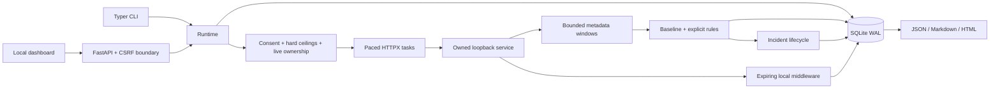

# Architecture

The package uses a standard `src` layout, organized by feature rather than a flat
collection of unrelated modules.

```text
src/ddos_sentinel/
  core/       configuration, capabilities, records, SQLite, audit
  lab/        owned service, paced scenarios, rolling telemetry, orchestration
  analysis/   normal baselines, explainable rules, pattern labels, metrics
  response/   incident grouping/lifecycle, expiring middleware controls
  commands/   CLI feature groups and shared output/error handling
  api/        FastAPI lifecycle, browser boundary, validated control routes
  reports/    consistent exports and escaped standalone HTML template
  web/        local dashboard templates, CSS and JavaScript
  cli.py      CLI composition and core commands
```



CLI `simulate` creates its own service, runs one experiment and closes it. It does
not attach to arbitrary listeners or a separate `lab start` process. `serve` owns
one longer-lived service so dashboard experiments share that lifecycle. `lab start`
is a foreground standalone service demonstration; its `/health` endpoint is public
on loopback but other endpoints require its in-process capability. `lab stop` uses
a database shutdown request for standalone commands only. Stop `serve` with Ctrl+C.

The service prebinds a socket before issuing its capability, avoiding a port-selection
race. Embedded Uvicorn does not replace the parent's signal handlers. Simulation tasks
are concurrency-bounded, paced by monotonic time, cancelled at the request deadline,
and awaited. In-flight service work is allowed a bounded drain before telemetry is
finalized. FastAPI lifespan shuts down running dashboard jobs and the test service.

SQLite uses short per-operation connections, WAL, a five-second busy timeout, explicit
transactions for grouped writes and parameterized values. Table/column SQL identifiers
come from code allowlists. Indexed metadata columns surround versioned JSON records,
keeping each feature's record fields readable without a heavy ORM. Schema user_version
is 1. Detections and incident updates commit together. Request samples commit in one
simulation-finalization transaction. No body, cookie or header fields exist in records.

At most 20,000 request samples are retained in memory; 60s at 200 req/s fits in this
buffer. The connection-identity deque holds at most 4,096 entries, so long-running
connection-churn counts are approximate. Active work is ASGI request concurrency,
not kernel TCP socket occupancy. History retention defaults to seven days and 50,000
rows per event table, preserving active records and the current baseline. Deleted
SQLite pages are reused; the database file need not immediately shrink. History can
be pruned, so reports explicitly describe retained rather than complete evidence.

All browser state changes require CSRF header/cookie checks. Host, client and Origin
checks keep the API on loopback. Controls receive strict Pydantic payloads with unknown
fields rejected. Static scripts use textContent for user data; templates autoescape.
No CDN, font provider or external analytics is used.
